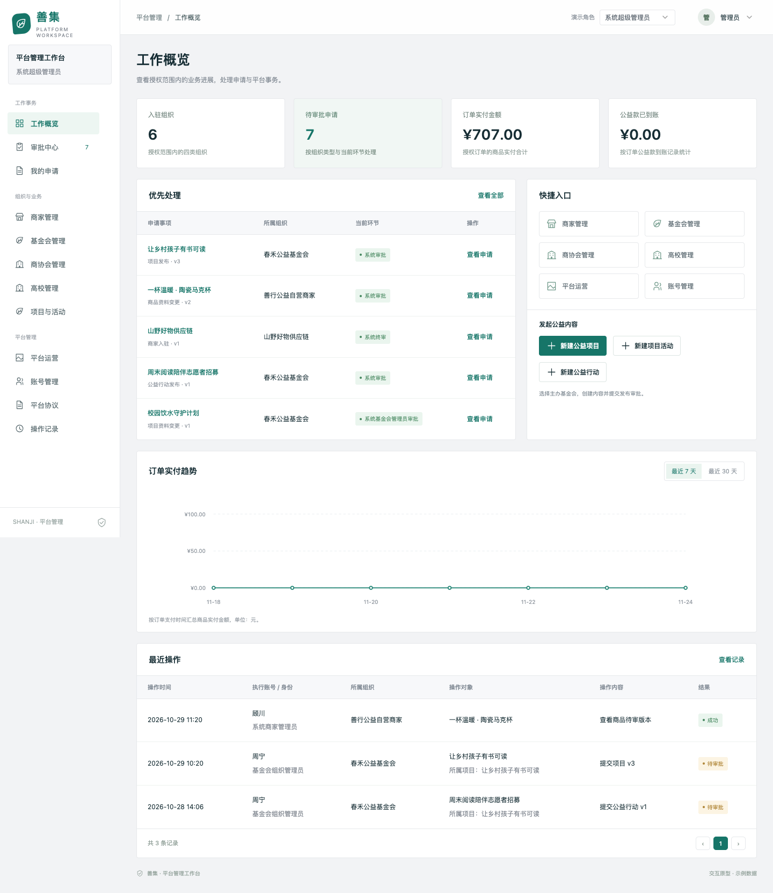
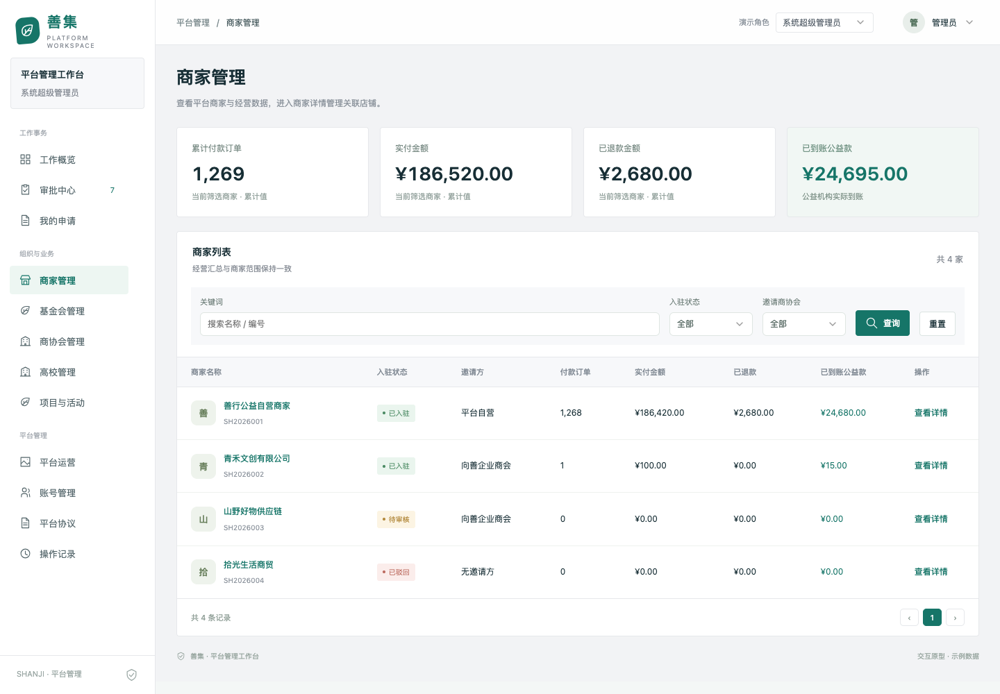
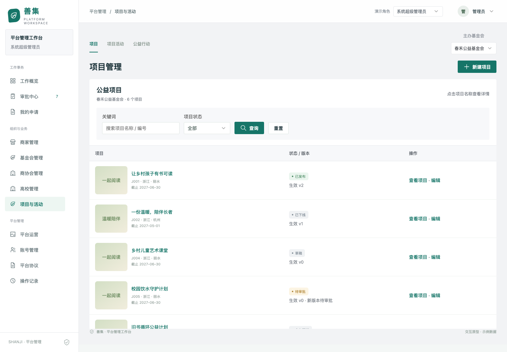
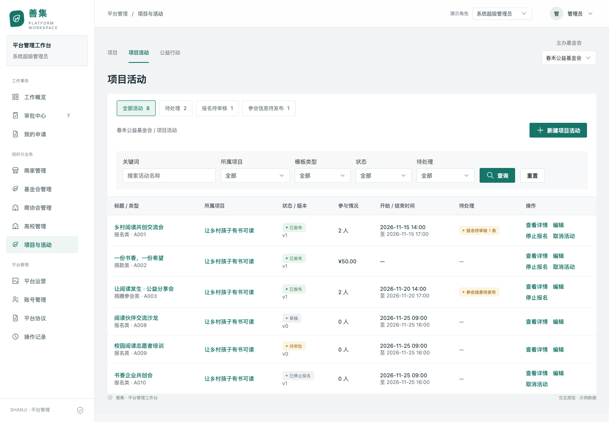
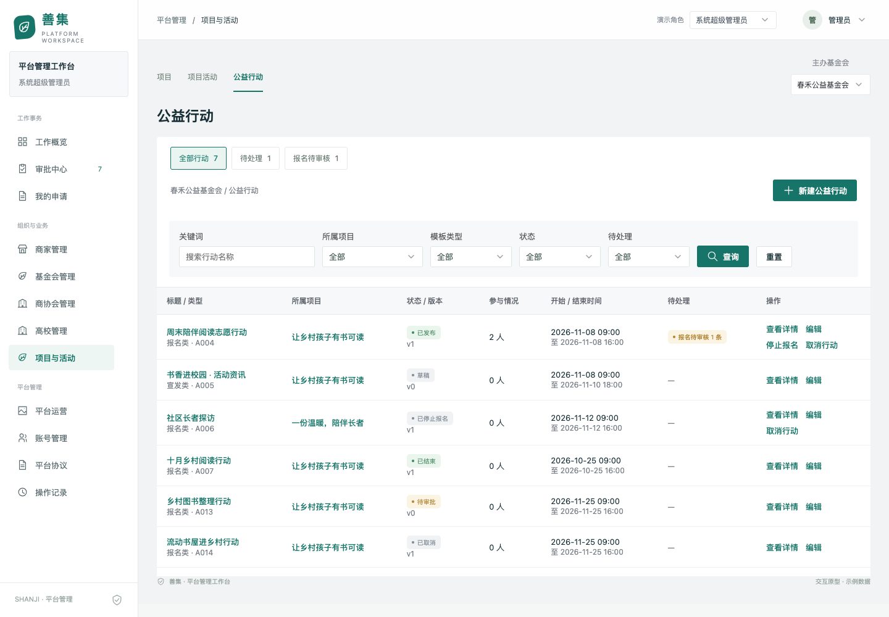
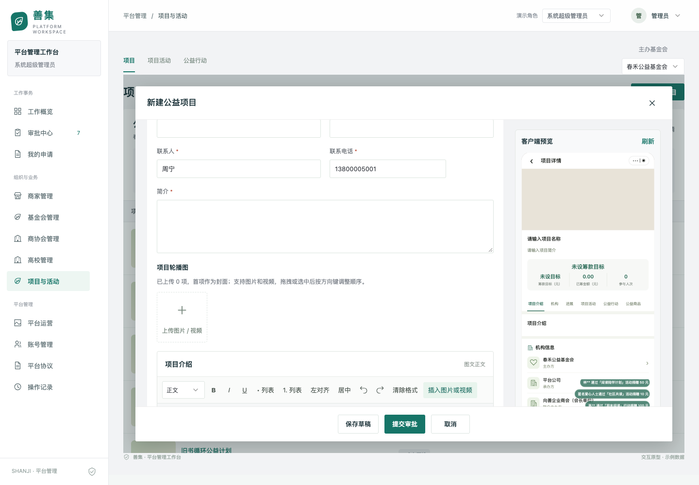
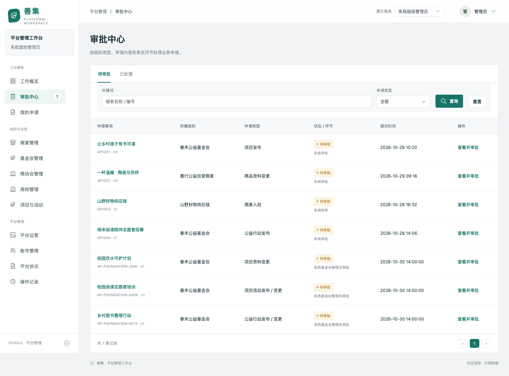
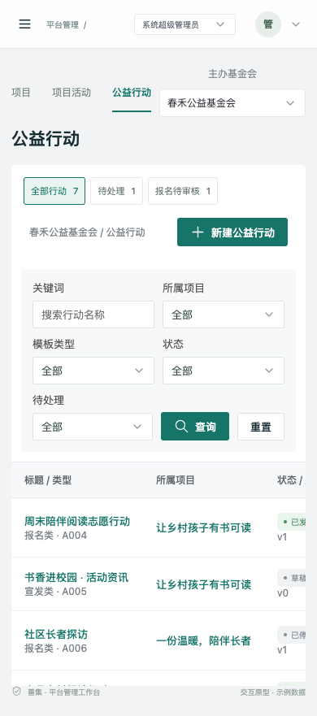

# 善集平台管理工作台原型截图

[打开本地工作台](index.html) · [公网工作台](https://zljiaa.github.io/charity-client-preview/workbench/roles/01-super-admin/index.html)

系统内部人员按授权管理善集业务，页面沿用商家工作台的灰底、白卡与绿色操作风格。顶部演示角色可切换系统超级管理员及商家、基金会、商协会、高校管理员，菜单与审批范围随角色变化。

## 工作概览

展示授权组织、待审批申请、订单实付及公益款到账，集中提供业务与公益内容新建入口；订单金额折线图支持 7 / 30 天。

## 商家管理

按商家进入组织资料、店铺、商品、订单与分账，保留原有查询、下钻和返回流程。

## 项目与活动

项目、项目活动、公益行动直接复用基金会工作台的列表、筛选与详情。系统基金会管理员及系统超级管理员选择主办基金会后，可创建三类内容。

## 项目活动与公益行动

两个列表均保留基金会工作台的所属项目、模板、状态、参与情况、时间、待处理事项和操作；详情沿用报名、捐赠、参会、通知与操作记录。

## 新建公益内容

创建和编辑直接使用基金会的表单、模板及校验，支持图文与轮播素材、草稿保存、真实客户端实时预览和提交审批；活动及行动关联所属项目。

## 审批中心

按系统角色、组织归属及当前环节查询申请，查看提交版本与客户端效果，审批通过或填写原因驳回。本人待审申请可撤回，修改后重新提交。

## 手机端

手机端折叠侧栏，统计和创建表单适配窄屏，业务表格可在卡片内横向查看。

本原型使用虚构数据，操作保存在当前浏览器，不连接真实业务服务。验证记录见角色目录中的验证文件。
